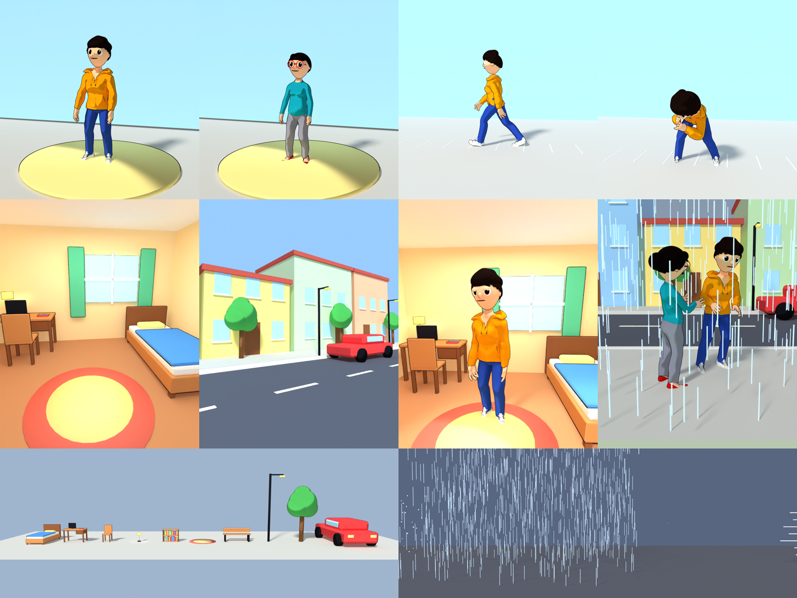

# BLENDER_ANIMATION — پوشه‌ی پروژه‌ی انیمیشن (سبک عروسکی «واگن آخر»)

```
BLENDER_ANIMATION/
├── CHARACTERS/   Main_Character.blend («من»)  ·  Secondary_Character.blend («مهسا»)
├── ENVIRONMENTS/ Bedroom.blend (اتاق خواب)  ·  Street.blend (خیابان)
├── ASSETS/
│   ├── Props/      Props.blend — تخت، میز، صندلی، چراغ، قفسه، فرش، نیمکت، تیر چراغ، درخت، ماشین
│   ├── Materials/  Toon_Materials.blend — پالت رنگ‌های تون + متریال خط‌دور
│   └── Effects/    Effects.blend — باران، گرد و غبار، ستاره‌ی ضربه، خطوط سرعت
├── ANIMATIONS/   Walk_Cycle.blend · Run_Cycle.blend · Reactions.blend
├── SHORTS/       Episode_01.blend («صبح») · Episode_02.blend («باران») · Renders/
└── _build/       اسکریپت‌هایی که همه‌ی فایل‌های بالا را می‌سازند
```



## هر پوشه چیست
| پوشه | محتوا | نکته |
|---|---|---|
| CHARACTERS | عروسک کامل (بدن MakeHuman + سر کارتونی با چشم/پلک/ابرو/دهان)، ۱۰ ثانیه نفس‌کشیدن با پلک‌زدن، روی صحنه با دوربین | هر شخصیت در کالکشنی به اسم خودش |
| ENVIRONMENTS | صحنه‌ها؛ هر کدام یک کالکشن (`Bedroom`، `Street`) با نور و دوربین نمونه | بدون تابلو، پرچم، نوشته یا جای واقعی |
| ASSETS/Props | هر وسیله یک کالکشن جدا و **Mark as Asset** شده | در Asset Browser بلندر کشیدنی است |
| ASSETS/Materials | همه‌ی رنگ‌های تون به‌صورت Asset + `Hull outline` (خط‌دور مشکی) | |
| ASSETS/Effects | `FX Rain` (Geometry Nodes، بی‌نهایت حلقه می‌شود)، `FX Dust`، `FX Impact` (۱۰ فریم)، `FX Speed lines` | |
| ANIMATIONS | راه رفتن و دویدن درجا (حلقه‌ای)، ۶ واکنش پشت سر هم با مارکر (scared, yes, no, forget it, thinking, wait) | حرکت‌ها از کلیپ‌های Mixamo در `blender/mocap` |
| SHORTS | قسمت‌های عمودی ۱۰۸۰×۱۹۲۰؛ صحنه و افکت را از فایل‌های بالا **Append** می‌کنند | خروجی رندر در `SHORTS/Renders/` |

## ساختن و رندر
```bash
blender/cast/setup.sh                                  # یک بار روی هر ماشین
blender/BLENDER_ANIMATION/_build/build_all.sh          # همه‌ی .blend ها از صفر (~۱۰ دقیقه)
blender/cast/bpy.sh blender/BLENDER_ANIMATION/_build/build_shorts.py --only ep1   # فقط یک فایل
blender/BLENDER_ANIMATION/_build/render_shorts.sh      # رندر پیش‌نمایش ۵۴۰×۹۶۰ → SHORTS/Renders/*.mp4
blender/BLENDER_ANIMATION/_build/render_shorts.sh --full   # رندر نهایی ۱۰۸۰×۱۹۲۰
```
- همه‌چیز در `_build/lib.py` است: رنگ‌ها (`PAL`)، وسایل (`bed()`, `car()`, ...)، صحنه‌ها (`bedroom()`, `street()`)، شخصیت‌ها و ذخیره.
  اگر وسیله یا صحنه را آنجا عوض کنی و `build_all.sh` را بزنی، همه‌ی فایل‌ها با هم به‌روز می‌شوند.
- قسمت جدید: `build_shorts.py` را کپی کن (Episode_03)، صحنه را با `lib.append(...)` بیاور، شخصیت با `lib.character(key)`،
  حرکت با `mocap.apply(...)`، صورت با `lib.faces(...)`، و در آخر `PP.finish(ch)`.
- رندر: Cycles، ۱۰ نمونه + Denoise. هیچ‌وقت دو رندر بلندر هم‌زمان اجرا نکن (حافظه).
