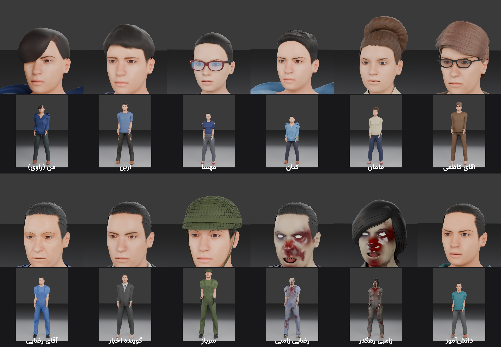

# Tolo Travel — the permanent cast (realistic)

Every film reuses these people. Don't invent new faces for a recurring role; add new
people here first (with a sheet), then use them.



## Rules (always)
- **No hijab** on anyone. **No flags, emblems, logos, insignia or place names** in any shot.
- Persian names, Iranian look: warm olive skin (`skin_tint=WARM`), mostly dark hair.
- POV films: the camera is **من** (the narrator). He is rarely seen.

## Who is who
| key | name | look | personality / role |
|---|---|---|---|
| `me` | من | boy 15, navy hoodie, jeans, dark side-swept hair | narrator, POV hero |
| `arian` | آرین | tall lanky boy 15, slate-blue polo, jeans, black hair | best friend, joker |
| `mahsa` | مهسا | girl 15, navy tee, grey trousers, red flats, **red glasses**, black hair tied back | sharp and brave |
| `kian` | کیان | small boy 13, light-blue hoodie, jeans, **green backpack** | youngest, scared, holds your hand |
| `mom` | مامان | woman 42, cream knitted sweater, navy trousers, brown hair in a **bun** | warm, worried, calls/voice notes |
| `kazemi` | آقای کاظمی | teacher 50, brown jacket outfit, **black glasses**, greying hair | strict but protects the kids |
| `rezaei` | آقای رضایی | janitor 58, **blue overalls**, grey hair | friendly; first to turn (`zombie=1`) |
| `anchor` | گوینده اخبار | man 45, dark suit, tie | TV news (plain studio, no logos) |
| `soldier` | سرباز | man 28, plain **olive** uniform, M1-style helmet, black gloves | rescuer — bitten above the right elbow |
| extras | دانش‌آموز / رهگذر | `spawn_extra("student", i)`, `spawn_extra("passerby", i)` | seeded, so student 3 always looks the same |

Any of them can be a zombie: `cast.spawn("arian", zombie=1.0)` gives grey-green bruised skin, dark veins,
dead white eyes, yellow teeth, blood around the mouth, chin, hands and wounds, and torn, dirty, bloody clothes.
`zombie=0.3` is "just turning". `bite=("upperarm_r", (0, 0, 0), 0.88)` adds only a fresh bite.

## How to use (Blender, Python)
```bash
blender/cast/setup.sh                    # once per machine (downloads MPFB + MakeHuman assets, ~1.4 GB)
blender/cast/bpy.sh my_film/scene.py     # runs a script with the cast available
blender/cast/bpy.sh blender/cast/sheet.py mahsa   # re-render a reference sheet
```
```python
import cast
mahsa = cast.spawn("mahsa")                       # quality="extra" for far-away people (cheaper)
for f in range(1, 241):
    t = (f - 1) / 24
    mahsa.animate(f, t, (x, y, 0), facing=90,        # 0 = looks along +Y, 90 = along -X
                  walk=1, phase=2 * math.pi * 0.9 * t,   # or run=1 / sit=1 / crouch=1 / shamble=1
                  arms="rest",                            # desk write wave reach push bang shamble run hug hold mug chalk
                  look=(30, -10), worry=1.5, talking=True)
mahsa.flush()                                     # writes the keyframes (fast, batched)
```
Faces: `worry` (0–2, fear brows + wide eyes), `talking` (lip flap for dubbing), `smile`, `scream`, blinking is automatic.

## Files
- `cast.py` — the cast table, `spawn`, `zombify`, props (mug, chalk, backpack)
- `anim.py` — procedural body poses + facial expressions
- `mpfb_tools.py` — MPFB helpers (build, recolour, paint masks, pose)
- `props.py` — realistic procedural materials (plaster, tiles, bricks, wood, glass) and simple geometry
- `sheets/` — reference renders (`<key>_face.png`, `<key>_full.png`, `overview.png`)
- `vendor/` — MPFB + assets (git-ignored; `setup.sh` recreates it)

Assets: MakeHuman community assets (CC0 and CC-BY) — see `CREDITS.md`.

## Fixed ElevenLabs voices (reuse in every film)
| key | voice | voice_id | notes |
|-----|-------|----------|-------|
| `mom` | Hengameh – Warm, Expressive, Storyteller | `9HVxKdwDzPJv4huwQfAt` | Persian, middle-aged; on the phone: highpass 320 / lowpass 3400 |
| `arian` | Amin.GS | `fvCP6Z9Dzulf2E6NsM8a` | young Persian male; `rubberband=pitch=1.12:formant=preserved` to sound like a boy |

Model `eleven_multilingual_v2`, loudnorm I=-18 per line (see `blender/mom_voice/voice.py`).
